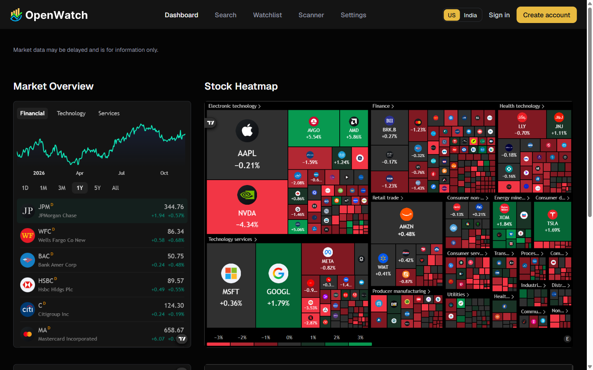
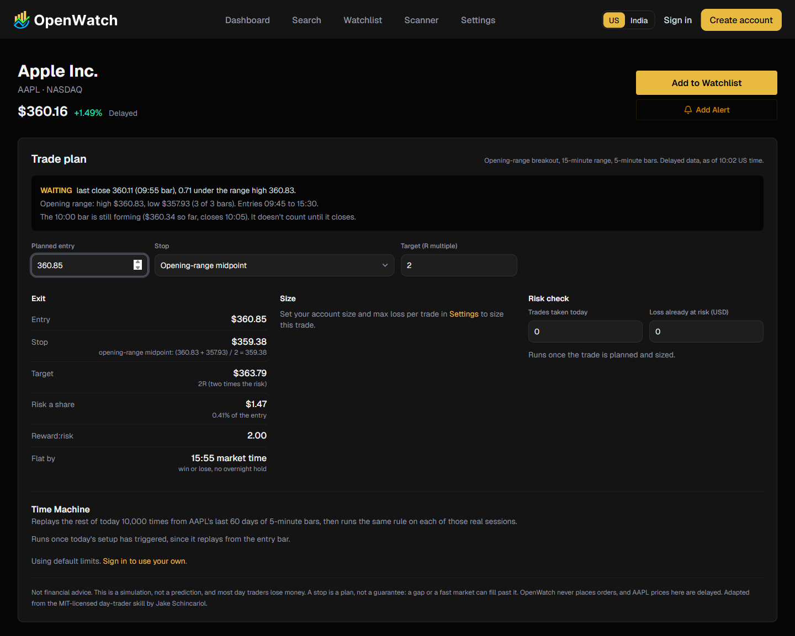
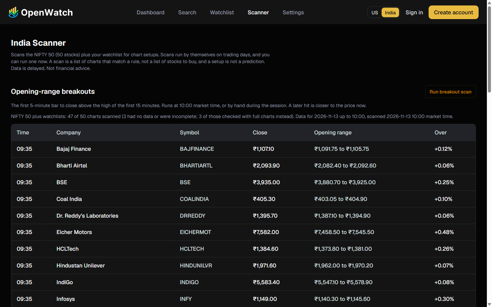
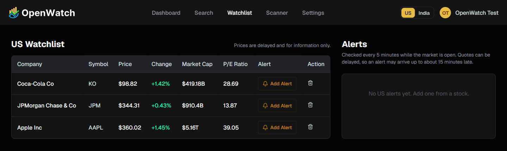

# OpenWatch

A read-only stock dashboard for the US and Indian (NSE and BSE) markets: search, stock pages with charts, watchlists, price alerts, a chart scanner, day-trading planning tools, and daily news digests by email. It started from a YouTube tutorial (Signalist) and is a personal portfolio project.

OpenWatch never places orders. Prices come from free, unofficial sources and are delayed. Nothing in it is financial advice, the Time Machine is a simulation rather than a prediction, and most day traders lose money.

Live at https://openwatch-phi.vercel.app. Guests can browse the dashboard, stock pages, search and scan results; the watchlist, alerts and settings need an account.

## Screenshots

The dashboard (US market), with TradingView's market overview and heatmap:



A stock page's trade plan: the opening-range check, then the exit plan for a planned entry. Position size and the risk check fill in once account limits are set in Settings:



The scanner's opening-range breakouts for the NIFTY 50:



A watchlist with delayed quotes and alerts:



## What it does

- **Two markets.** A switcher moves the whole app between the US (NASDAQ, NYSE, AMEX, prices in USD) and India (NSE and BSE, prices in INR), with each market's hours, holidays and currency.
- **Search, stock pages and watchlists.** Delayed quotes, TradingView charts, company news, and a watchlist per market.
- **Price alerts.** Above, below, stop, target, percent move, time of day and opening bell. Each alert rings once, in the app and by email.
- **Trade tools.** An opening-range entry check, exit plan, position size, a PASS or BLOCK risk check against your own limits, and the Time Machine, which replays the rest of the session 10,000 times from the stock's own past candles. Every panel ends in a plan on screen, never an order.
- **Scanner.** Opening-range breakouts and daily setups (20-day high, bull flag, reclaimed 20-day average, oversold, oversold bounce) over the S&P 500 or NIFTY 50 plus watchlists, on a schedule or on demand.
- **Emails.** A welcome email, a daily news digest per market after the close, and alert emails. The digest and alert emails can be turned off in Settings.

## Running it locally

You need Node.js 22.12 or newer and a MongoDB database (a free MongoDB Atlas cluster works).

1. Install dependencies: `npm install`
2. Copy `.env.example` to `.env.local` and fill it in (see the table below). Every value is server-side only.
3. Start the app: `npm run dev`, then open http://localhost:3000 and sign up.
4. For background jobs (price alerts, scans, the welcome email and daily digests), set `INNGEST_DEV=1` in `.env.local` and run the Inngest dev server in a second terminal:

   ```bash
   npx inngest-cli@latest dev -u http://localhost:3000/api/inngest --no-discovery
   ```

   Its dashboard at http://localhost:8288 shows the jobs and can trigger them by hand, for example `app/digest.in` for the India digest.

| Variable | What it is |
| --- | --- |
| `MONGODB_URI` | MongoDB connection string. |
| `BETTER_AUTH_SECRET` | A long random string for signing sessions, for example from `openssl rand -base64 32`. |
| `BETTER_AUTH_URL` | The app's own URL: `http://localhost:3000` locally, the production URL when deployed. |
| `FINNHUB_API_KEY` | A free key from finnhub.io, for US search, company profiles and news. |
| `OPENAI_API_KEY` | Writes the welcome intro and digest summaries. Without it, emails use plain text. |
| `NODEMAILER_EMAIL`, `NODEMAILER_PASSWORD` | A Gmail address and a Google app password (not the account password). |
| `INNGEST_DEV` | `1` locally, so jobs go to the Inngest dev server. Leave it unset in production. |
| `INNGEST_EVENT_KEY`, `INNGEST_SIGNING_KEY` | From Inngest Cloud, production only. |

## Commands

| Command | What it does |
| --- | --- |
| `npm run dev` | Development server on port 3000. |
| `npm test` | Unit tests (Vitest). `npm run test:watch` reruns them on save. |
| `npm run lint` | ESLint. |
| `npm run typecheck` | TypeScript, without emitting files. Run it after a build so Next's route types exist. |
| `npm run build` | Production build. It needs no secrets. |

GitHub Actions runs lint, tests, build and typecheck on every pull request and every push to `main`.

The tests cover the pure code: alert rules, the trade tools, the Time Machine, the scanner, market hours and holidays, symbol conversion, news filtering, AI text checks, the digest window, email templates, validation and rate limits. The trade tools are checked against the day-trader skill's worked TSLA example, using its fixtures in `tests/fixtures/skill`.

## Deploying

The app runs on Vercel, the database on MongoDB Atlas and the background jobs on Inngest Cloud. All three have free plans that fit a few users.

1. **Atlas.** Create a database user, and allow access from anywhere (`0.0.0.0/0`) under Network Access: Vercel functions don't have fixed IP addresses on the free plan, so the database password is what protects it.
2. **Vercel.** Import the GitHub repository and set the variables from the table above, with `BETTER_AUTH_URL` set to the production URL and `INNGEST_DEV` left out.
3. **Inngest.** Install the Inngest integration for Vercel, which sets `INNGEST_EVENT_KEY` and `INNGEST_SIGNING_KEY` and syncs the app on every deploy. Also set `INNGEST_SERVE_ORIGIN` to the production URL (for example `https://openwatch-phi.vercel.app`): the integration otherwise syncs each deployment's own URL, which Vercel's default deployment protection blocks, and the sync fails as an "unattached sync". To sync by hand, run `curl -X PUT https://<your-app>/api/inngest`.
4. Redeploy so the new variables apply, sign up, and set an alert at a price the stock has already passed. The next check (every 5 minutes while the market is open) should ring it and send one email.

Long jobs have a 300-second limit, the most Vercel's free plan allows with Fluid compute: the Inngest route and the scanner page set `maxDuration = 300`. A US breakout scan usually takes about a minute.

## Email

Emails go out through Gmail SMTP using `NODEMAILER_EMAIL` and a Google app password in `NODEMAILER_PASSWORD`.

- **Sending limits.** A personal Gmail account can send about 500 messages a day, and Google blocks sending for up to a day once that is passed ([Gmail's limits](https://support.google.com/mail/answer/22839)). Each user gets at most one welcome email, one digest per market per trading day and one email per alert that rings, so this is fine for a handful of users but not for a public app. A larger audience needs a transactional email service.
- **Opting out.** The digest and alert emails can be turned off under Settings, and every one of them links there. The welcome email always goes out.
- **AI text.** The welcome intro and the digest summary are written by OpenAI and fall back to plain text when the API is unavailable or the text breaks the rules (no live-price claims, no advice).

## Data sources and limits

| Data | Source |
| --- | --- |
| Quotes and price history, both markets | Yahoo Finance |
| US search, company profiles and news | Finnhub (free key) |
| Indian search | A bundled NSE symbol list (`node scripts/seed-nse-symbols.mjs` refreshes it) |
| Indian news | Google News RSS search by company name |
| Charts on stock pages and the dashboard | TradingView widgets (Indian stocks use their BSE listing) |
| Index members for the scanner | Wikipedia (`node scripts/seed-index-members.mjs`) |

All of these are free and unofficial, so any of them can be slow, delayed (often by about 15 minutes) or briefly unavailable, and the app shows "data unavailable" when they are. An alert can therefore ring up to about 15 minutes late. The free sources have no Indian market cap or P/E, so those show a dash. NSE holidays are only published through 2026, so `lib/market/holidays.ts` needs the 2027 list before the year ends.

## Credits and licence

- Started from the Signalist stock market app tutorial on YouTube.
- The alerts, trade tools, Time Machine and scanner are ported from [Jakeschincariol/day-trader-skill](https://github.com/Jakeschincariol/day-trader-skill) (MIT License, Copyright (c) 2026 Jake Schincariol). The licence text is in `lib/trade/LICENSE`, and the copied test fixtures carry it in `tests/fixtures/skill/LICENSE`.
