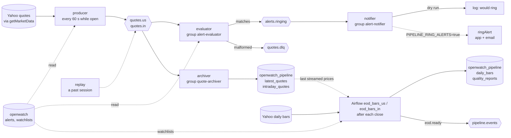
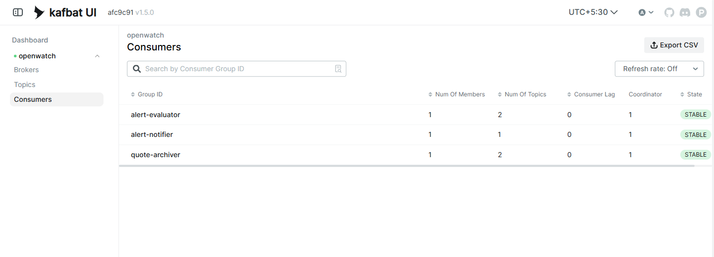
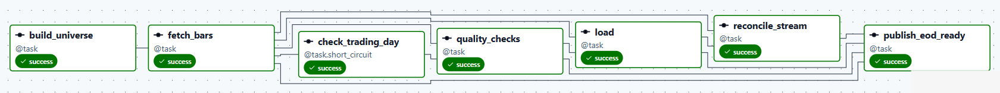
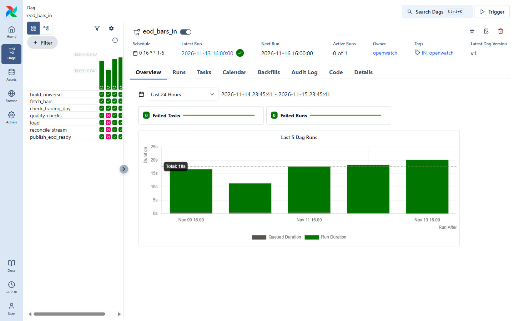

# OpenWatch data pipeline

A data pipeline that runs beside the OpenWatch app, locally in Docker. The app on Vercel doesn't depend on it. It has two halves:

- **Streaming (Kafka):** one producer polls delayed quotes for the stocks people watch, and several independent consumers read the same stream, each at its own pace. One evaluates price alerts, one notifies, and one archives every quote to MongoDB.
- **Batch (Airflow):** after each market closes, a DAG loads that day's official daily bars for the whole index, checks their quality, compares them with what the stream recorded, and announces the day on Kafka.



## Why Kafka here

The app already checks alerts with an Inngest cron job, which fetches quotes, evaluates them and moves on. Kafka earns its place when more than one thing wants the same data. Here one Yahoo poll feeds every reader:

- The **evaluator** and the **archiver** read the same `quotes.*` topics in separate consumer groups. Each keeps its own committed offsets, so one can stop, fall behind and catch up without slowing the other or asking Yahoo again.
- A new reader (a live price badge, scanner precomputation) joins with a new group and needs no extra API calls.

Inngest still handles the app's own events (welcome emails, digests, the alert cron). Time and opening-bell alerts stay there too, because they need a clock, not a price.

## Running it

You need Docker, Node 22.22+ and the app's `.env.local` (the worker reads `MONGODB_URI` from it).

```bash
docker compose -f pipeline/docker-compose.yml --profile ui up -d   # Kafka, plus Kafbat UI on http://localhost:8081
cd pipeline/worker
npm install
npm run topics          # create the topics (every service also does this on startup)
```

Then, each in its own terminal:

```bash
npm run evaluator
npm run notifier        # dry run unless PIPELINE_RING_ALERTS=true
npm run archiver
npm run producer        # polls while a market is open; `-- --once` for one poll
```

Outside market hours, replay a finished session instead of running the producer:

```bash
npm run replay -- --market IN                                   # latest session, watched stocks
npm run replay -- --market US --date 2026-11-13 --speed 120 --symbols NASDAQ:AAPL,NYSE:KO
```

At `--speed 60` a 5-minute bar goes out every 5 seconds, so a full session takes about 6 minutes. Yahoo keeps 5-minute bars for 60 days, which limits the dates.

Stop with Ctrl+C. `docker compose -f pipeline/docker-compose.yml stop` keeps the topics. `down`, or anything that recreates the container, deletes them, and the services recreate them on their next start.

For Airflow, run from the repo root. `--env-file` passes `MONGODB_URI` from `.env.local`, and nothing else from that file reaches the container:

```bash
docker compose --env-file .env.local -f pipeline/docker-compose.yml --profile ui --profile airflow up -d --build
```

Airflow's UI is on http://localhost:8080 with no login: every visitor is an admin. That's acceptable only because every port in the compose file is bound to `127.0.0.1`. The DAGs start paused, so unpause one in the UI (or with `docker exec openwatch-airflow airflow dags unpause eod_bars_in`). Airflow's run history lives in the container, so it survives `stop` but not a recreate. The loaded data lives in MongoDB.

## Topics

| Topic | Partitions | Key | Holds |
|-------|-----------:|-----|-------|
| `quotes.us`, `quotes.in` | 3 | `EXCHANGE:TICKER` | one message per quote, kept 1 day |
| `alerts.ringing` | 3 | alert id | alerts whose condition held |
| `quotes.dlq` | 1 | original key | quotes that failed validation, with `error`, `source-topic`, `source-partition` and `source-offset` headers |
| `pipeline.events` | 1 | `MARKET:DATE` | Airflow's `eod.ready` once a day is loaded |

Auto-creation is off on the broker, so `src/topics.ts` is the only place topics come from.

## Design notes

- **Ordering.** Quotes are keyed by stock, so every quote for one stock lands on one partition and every consumer sees them in order.
- **At-least-once, with idempotent writes.** Each consumer commits an offset only after its handler has finished, including any message it produces (`processThenCommit`). A crash means a message is read again, so every write tolerates repeats:
  - the archiver's rows are unique per stock, quote time and source, so a repeat is a no-op;
  - `latest_quotes` only moves forward in time;
  - the app's `ringAlert` only claims an alert that is still active, so a repeated ring, or one Inngest already rang, notifies nobody.
- **Idempotent producer.** Producers use `idempotent: true` with `acks: all`, so a retried send doesn't write a duplicate.
- **Dead letters.** A malformed quote goes to `quotes.dlq` with the error and its origin in the headers, and the stream carries on. Only the evaluator dead-letters, so each bad message lands there once.
- **Dry run by default.** The notifier logs `would ring …`. `PIPELINE_RING_ALERTS=true` makes it ring live alerts through the app's `ringAlert`, in the app and by email.
- **Replay safety.** Replayed quotes carry `source: "replay"`. The notifier never rings them, whatever the flag says, and the archiver never lets them replace a current price.
- **One ring per alert per day.** The evaluator remembers what it has sent, so a price that stays past its level rings once, not on every quote.
- **Separate database.** The worker reads the app's `openwatch` database (alerts, watchlists) and writes only to `openwatch_pipeline`. `intraday_quotes` expires after 7 days, counted from when a row was written, so a replayed old session isn't deleted on arrival.
- **Shared code, one direction.** The worker imports the app's market data layer and alert rules from `lib/`. The app never imports from `pipeline/`. Scripts run under `tsx --conditions=react-server`, which resolves `server-only` to its empty build, the same trick `vitest.config.mts` uses.
- **Versions.** Kafka 4.2.2 in KRaft mode on one node, because `@platformatic/kafka` 2.15 is tested against Kafka up to 4.2. (`kafkajs` hasn't had a release since 2023.)

## The lag demo

Replay of five NSE stocks for 2026-11-13 at 60x, with the archiver stopped partway through.

All topics, with the replayed quotes, one ring and one dead-lettered message:


The archiver is stopped (no members). The evaluator and notifier carry on at lag 0 while the archiver falls 80 messages behind:


Restarted, it resumes from its last committed offset and is back to lag 0 within seconds:



Meanwhile the notifier logged the one ring the replay produced, as a dry run:

```
would ring 6af4261d6346198c56a02e92 (replay): ITC is ₹282.85: at or above your alert level ₹1.00 (Phase 7 production check).
```

## Airflow: end-of-day bars

`airflow/dags/eod_bars.py` uses one factory to build two DAGs: `eod_bars_us` at 16:30 New York time and `eod_bars_in` at 16:00 Kolkata time, Monday to Friday. Each run covers its own trading day.



1. **build_universe:** the market's index (S&P 500 or NIFTY 50, from `lib/market/data/index-members.json`) plus every watchlist stock, converted to Yahoo symbols the way the app's `toYahoo()` does.
2. **fetch_bars:** each stock's daily bar for the day, plus the close before it, from Yahoo's chart API. It sends the app's honest User-Agent, 5 stocks at a time, half a second apart. The bars pass to later tasks through a file rather than the XCom table, because there are about 550 of them.
3. **check_trading_day** (short-circuit): if almost no stock has a bar, the market was closed, so the run stops there as a success. No copy of the holiday calendar is needed.
4. **quality_checks:** missing bars, zero volume, a move of more than 20% from the previous close, a close outside the day's range, and high below low. The report is saved to `openwatch_pipeline.quality_reports` first. The run then fails if more than 10% of bars are missing or any bar is impossible, so a broken Yahoo day is visible in Airflow.
5. **load:** upserts `openwatch_pipeline.daily_bars`, one document per stock per day. Re-running a day replaces it.
6. **reconcile_stream:** compares each stock's last streamed price from the Kafka archiver (`intraday_quotes`) with the official close just loaded. It writes coverage, each stock's difference and anything over 1% into the day's quality report. It reports but never fails a run.
7. **publish_eod_ready:** `{"type": "eod.ready", "market", "date", "symbols", "loaded", "missing", "streamed", "drifted"}` to `pipeline.events`, as the hook for later consumers (scanner precomputation).

Tasks retry twice with exponential backoff, and only one run of a DAG is active at a time.

**Schedules and dates.** The schedules are `CronTriggerTimetable` objects in each market's time zone. A bare cron string would be read in UTC; the DAG test caught the US job set to run at 11:30 New York time. With this timetable, a run's logical date is its trigger time, so the 16:30 run on 2026-11-13 is dated 2026-11-13, the session that just closed. A manual run can name any day with the `date` param:

```bash
docker exec openwatch-airflow airflow dags trigger eod_bars_in --conf '{"date": "2026-11-13"}'
```

**Backfill.** Airflow 3 creates a backfill and the scheduler runs it:

```bash
docker exec openwatch-airflow airflow backfill create --dag-id eod_bars_us \
  --from-date 2026-11-09 --to-date 2026-11-14 --reprocess-behavior failed
```

`--to-date` is a moment, not a whole day: `2026-11-13` means midnight at its start, which leaves out that day's 16:30 run. Pass the day after the last one you want.

### What the checks showed

- **A week of backfill:** `eod_bars_us` for 2026-11-09 to 2026-11-13 loaded all 503 S&P 500 bars each day, with nothing missing, no zero volume and no big moves.
- **A holiday:** `eod_bars_in` for 2026-11-10 (Diwali-Balipratipada, NSE closed) found 0 of 50 bars, so check_trading_day stopped the run and everything after it was skipped:



- **Stream against batch:** after the lag demo's replay of five NSE stocks for 2026-11-13, reconcile_stream matched all five to the official close at 0.00% difference. That's by construction for a replay, not proof that the stream is perfect: Yahoo's last 5-minute bar of the session closes at the official close, and the replay ends on it. Real differences should show with live polling, whose last quote lands before the close. NSE's official close has also been a weighted average of late trades rather than the last trade. Check the exchange's current method before reading much into Indian differences.

## Tests

- The worker's pure parts (message parsing, which stocks to poll, replay planning, and every handler with fake Kafka and database calls) run in the app's Vitest suite: `tests/pipeline-*.test.ts`. CI also typechecks the worker.
- The Airflow modules (universe, Yahoo parsing against a saved response, quality, reconcile) run with `pytest pipeline/airflow/tests`, locally and in CI's `pipeline-airflow` job (`pip install -r pipeline/airflow/requirements-test.txt` first).
- The DAG integrity test (imports, schedules and time zones, task order) needs Airflow, so it runs inside the container: `docker exec -w /tmp openwatch-airflow python -m pytest -p no:cacheprovider /opt/airflow/tests`.
- Tests never touch a real broker, database or Yahoo.

## Kinesis

The same design maps onto AWS Kinesis: a stream per market with shards in place of partitions, partition keys by stock, and one KCL application per consumer group, with checkpoints in place of committed offsets. Kafka was chosen because it runs free in Docker. Likewise, Airflow was chosen over Prefect because it's more common in job listings; the DAG would map onto a Prefect flow with tasks and a cron deployment.
