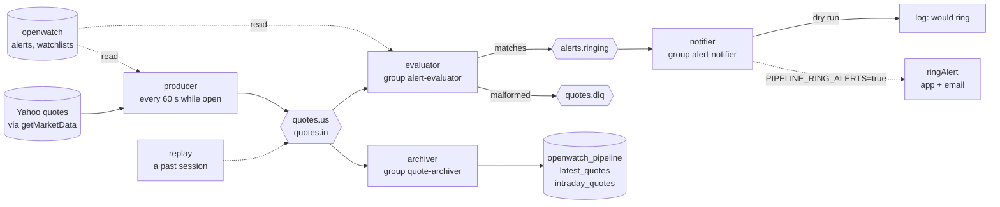
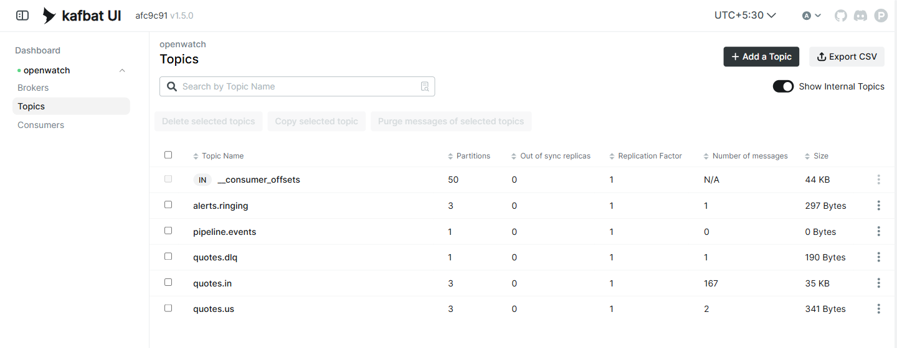
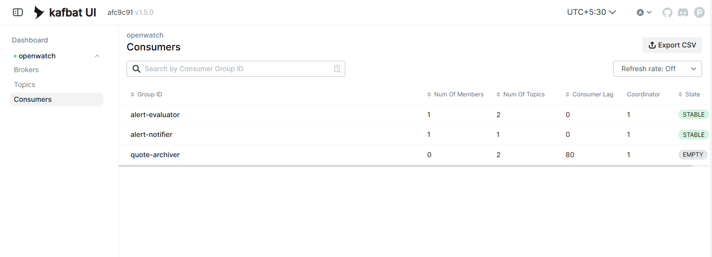

# OpenWatch data pipeline

A Kafka quote stream that runs beside the OpenWatch app. One producer polls delayed quotes for the stocks people watch, and several independent consumers read the same stream, each at its own pace: one evaluates price alerts, one notifies, and one archives every quote to MongoDB. It runs locally in Docker. The app on Vercel doesn't depend on it.

Airflow end-of-day batch jobs are the second half of this pipeline (Phase 8b, not built yet).



## Why Kafka here

The app already checks alerts with an Inngest cron job, which fetches quotes, evaluates them and moves on. Kafka earns its place when more than one thing wants the same data. Here one Yahoo poll feeds every reader:

- The **evaluator** and the **archiver** read the same `quotes.*` topics in separate consumer groups. Each keeps its own committed offsets, so one can stop, fall behind and catch up without slowing the other or asking Yahoo again.
- A new reader (a live price badge, scanner precomputation) joins with a new group and needs no extra API calls.

Inngest still handles the app's own events (welcome emails, digests, the alert cron). Time and opening-bell alerts stay there too, because they need a clock, not a price.

## Running it

You need Docker, Node 22.22+ and the app's `.env.local` (the worker reads `MONGODB_URI` from it).

```bash
docker compose -f pipeline/docker-compose.yml --profile ui up -d   # Kafka, plus Kafbat UI on http://localhost:8081
cd pipeline/worker
npm install
npm run topics          # create the topics (every service also does this on startup)
```

Then, each in its own terminal:

```bash
npm run evaluator
npm run notifier        # dry run unless PIPELINE_RING_ALERTS=true
npm run archiver
npm run producer        # polls while a market is open; `-- --once` for one poll
```

Outside market hours, replay a finished session instead of running the producer:

```bash
npm run replay -- --market IN                                   # latest session, watched stocks
npm run replay -- --market US --date 2026-11-13 --speed 120 --symbols NASDAQ:AAPL,NYSE:KO
```

At `--speed 60` a 5-minute bar goes out every 5 seconds, so a full session takes about 6 minutes. Yahoo keeps 5-minute bars for 60 days, which limits the dates.

Stop with Ctrl+C. `docker compose -f pipeline/docker-compose.yml stop` keeps the topics; `down` deletes them, and the services recreate them on their next start.

## Topics

| Topic | Partitions | Key | Holds |
|-------|-----------:|-----|-------|
| `quotes.us`, `quotes.in` | 3 | `EXCHANGE:TICKER` | one message per quote, kept 1 day |
| `alerts.ringing` | 3 | alert id | alerts whose condition held |
| `quotes.dlq` | 1 | original key | quotes that failed validation, with `error`, `source-topic`, `source-partition` and `source-offset` headers |
| `pipeline.events` | 1 | | reserved for Airflow's `eod.ready` (Phase 8b) |

Auto-creation is off on the broker, so `src/topics.ts` is the only place topics come from.

## Design notes

- **Ordering.** Quotes are keyed by stock, so every quote for one stock lands on one partition and every consumer sees them in order.
- **At-least-once, with idempotent writes.** Each consumer commits an offset only after its handler has finished, including any message it produces (`processThenCommit`). A crash means a message is read again, so every write tolerates repeats:
  - the archiver's rows are unique per stock, quote time and source, so a repeat is a no-op;
  - `latest_quotes` only moves forward in time;
  - the app's `ringAlert` only claims an alert that is still active, so a repeated ring, or one Inngest already rang, notifies nobody.
- **Idempotent producer.** Producers use `idempotent: true` with `acks: all`, so a retried send doesn't write a duplicate.
- **Dead letters.** A malformed quote goes to `quotes.dlq` with the error and its origin in the headers, and the stream carries on. Only the evaluator dead-letters, so each bad message lands there once.
- **Dry run by default.** The notifier logs `would ring …`. `PIPELINE_RING_ALERTS=true` makes it ring live alerts through the app's `ringAlert`, in the app and by email.
- **Replay safety.** Replayed quotes carry `source: "replay"`. The notifier never rings them, whatever the flag says, and the archiver never lets them replace a current price.
- **One ring per alert per day.** The evaluator remembers what it has sent, so a price that stays past its level rings once, not on every quote.
- **Separate database.** The worker reads the app's `openwatch` database (alerts, watchlists) and writes only to `openwatch_pipeline`. `intraday_quotes` expires after 7 days, counted from when a row was written, so a replayed old session isn't deleted on arrival.
- **Shared code, one direction.** The worker imports the app's market data layer and alert rules from `lib/`. The app never imports from `pipeline/`. Scripts run under `tsx --conditions=react-server`, which resolves `server-only` to its empty build, the same trick `vitest.config.mts` uses.
- **Versions.** Kafka 4.2.2 in KRaft mode on one node, because `@platformatic/kafka` 2.15 is tested against Kafka up to 4.2. (`kafkajs` hasn't had a release since 2023.)

## The lag demo

Replay of five NSE stocks for 2026-11-13 at 60x, with the archiver stopped partway through.

All topics, with the replayed quotes, one ring and one dead-lettered message:



The archiver is stopped (no members). The evaluator and notifier carry on at lag 0 while the archiver falls 80 messages behind:



Restarted, it resumes from its last committed offset and is back to lag 0 within seconds:


Meanwhile the notifier logged the one ring the replay produced, as a dry run:

```
would ring 6af4261d6346198c56a02e92 (replay): ITC is ₹282.85: at or above your alert level ₹1.00 (Phase 7 production check).
```

## Tests

The pure parts (message parsing, which stocks to poll, replay planning and every handler with fake Kafka and database calls) run in the app's Vitest suite: `tests/pipeline-*.test.ts`. CI also typechecks the worker. Tests never touch a real broker, database or Yahoo.

## Kinesis

The same design maps onto AWS Kinesis: a stream per market with shards in place of partitions, partition keys by stock, and one KCL application per consumer group, with checkpoints in place of committed offsets. Kafka was chosen because it runs free in Docker.
